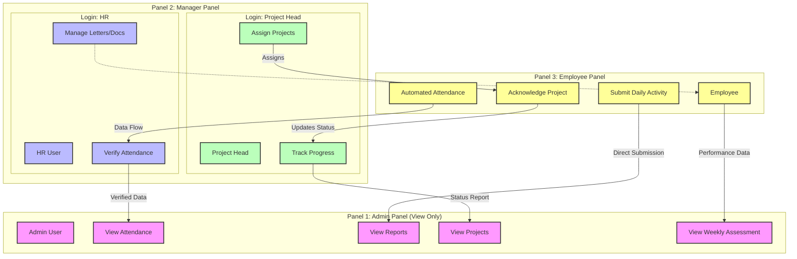

# System Workflow & UI Flow Diagram

This document defines the strict workflow and UI flow for the Company Management System, structured into three distinct panels. Responsibilities are assigned based on the "Arrow-Based Flow Rule": **The element where the arrow ends owns the action.**

## Arrow-Based Responsibility Rules

1.  **Attendance**: Employee (Automated) $\rightarrow$ HR (Verify). **HR is responsible for Verification.** Admin only views.
2.  **Project Assignment**: Project Head $\rightarrow$ Employee (Acknowledge). **Project Head Assigns**, **Employee Acknowledges.**
3.  **Reporting**: Employee $\rightarrow$ Admin (View). **Admin Views Only.**
4.  **Operational Tasks**: Admin does **NOT** execute operational tasks. Admin is for Monitoring & Viewing.

## Panel Structure

### 1. Admin Panel
*Context*: Super Admin / Admin User.
*Role*: Viewing & Monitoring.

| Module | Direction / Source | Responsibility (Admin) |
| :--- | :--- | :--- |
| **Attendance** | $\leftarrow$ From HR (Verified Data) | **View Only**. Monitor check-in/out times. |
| **Daily Activity** | $\leftarrow$ From Employee | **View Only**. Check daily reports. |
| **Weekly Assessments** | $\leftarrow$ From Employee Data | **View Only**. Analyze weekly performance. |
| **Projects** | $\leftarrow$ From Project Head | **View Only**. Monitor project status. |
| **HR Data** | $\leftarrow$ From HR | **View Only**. Monitor HR stats. |

> **Strict Rule**: Admin does **NOT** verify attendance or assign projects.

---

### 2. Manager Panel
*Context*: Login-Based Dynamic View. No standalone "Manager" role.

#### A. Login as HR
*Role*: Operational / Verification.

| Module | Direction | Responsibility (HR) |
| :--- | :--- | :--- |
| **Attendance** | $\leftarrow$ From Employee (System) | **Verify**. HR confirms attendance status (Present/Absent/Excused). |
| **Letters & Docs** | $\rightarrow$ To Employee | **Issue**. HR handles Warning Letters, Joining Docs. |
| **Employee Records** | $\leftrightarrow$ Internal | **Manage**. HR maintains employee database. |

#### B. Login as Project Head
*Role*: Operational / Assignment.

| Module | Direction | Responsibility (Project Head) |
| :--- | :--- | :--- |
| **Projects** | $\rightarrow$ To Employee | **Assign**. Project Head creates and allocates projects. |
| **Project Progress** | $\leftarrow$ From Employee | **Track**. Project Head monitors task completion. |

> **Note**: Marketing and Finance modules are **completely removed**.

---

### 3. Employee Panel
*Context*: General Staff.
*Role*: Execution / Submission.

| Module | Direction | Responsibility (Employee) |
| :--- | :--- | :--- |
| **Attendance** | $\rightarrow$ To System/HR | **Automated**. System logs time; Employee views own history. |
| **Daily Activity** | $\rightarrow$ To Admin | **Submit**. Employee logs daily tasks/reports. |
| **Projects** | $\leftarrow$ From Project Head | **Acknowledge**. Employee views and updates assigned tasks. |
| **Weekly Assessment** | $\rightarrow$ To Admin | **Appear**. Data aggregates into weekly assessments. |

---

## Visual Flow Diagram

